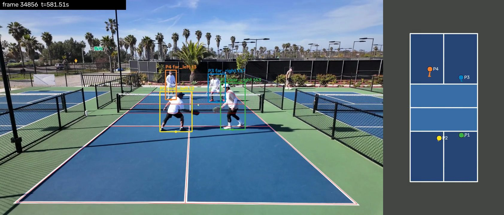
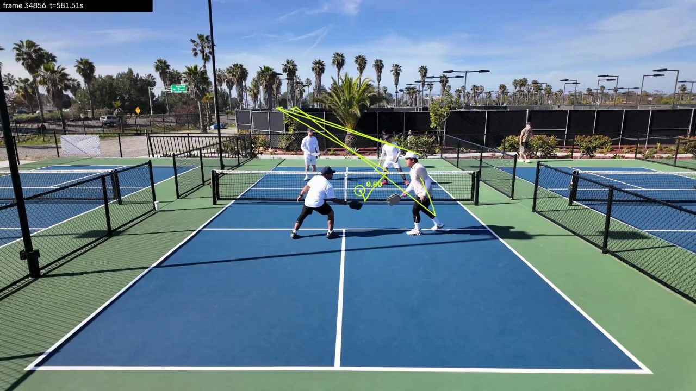

# Pickleball Match Intelligence

A full-stack computer-vision and machine-learning project for turning ordinary smartphone pickleball footage into structured match data, interactive analytics, and tactical insights.

## Vision

The application should eventually let a player upload a match and receive:

- automated rally segmentation
- player and ball tracking
- court-position heatmaps
- movement and kitchen-transition statistics
- shot placement and shot-selection analytics
- recurring strategic-pattern detection
- evidence-backed coaching insights linked to specific rallies

The project intentionally separates perception from reasoning:

```text
Video
  -> Court calibration
  -> Player tracking
  -> Ball tracking
  -> Rally / hit / shot events
  -> Structured match representation
  -> Analytics
  -> Coaching explanation
```

## Current Status

Phases 0-2 of 12 are done. Phase 3 (player tracking in the app) is next. Updated
2026-11-04; the detail is in `docs/ROADMAP.md`.

| Phase | Status |
|---|---|
| 0a. CV prototype on one video | Done |
| 0b. Feasibility across four matches | Done, exit criterion passed |
| 1. Full-stack skeleton: upload, database, background jobs | Done |
| 2. Court calibration in the web app | Done |
| 3. Player tracking in the app | Next |
| 4. Ball tracking | Baseline only, from Phase 0b |
| 5-12. Rallies, analytics, corrections, hits, shots, tactics, coaching, automatic court detection | Not started |

### Player and ball tracking today

Tracking runs in the Phase 0 command-line pipeline only. The web app doesn't track
yet; that is Phase 3. Both images are the same moment of a held-out test window
(`buzz_b`, 9:41), rendered by `pbml render` and the ball debug render.



Players: boxes, identities and court slots on the frame, and the same four players
projected onto a top-down court. On the four test windows that influenced no
decision, 86% of visible players were detected, every one with the right identity,
and there were no ID switches.



Ball: the detected position with its score, and the recent trail. This is a tennis
model used as is, so it's only partly usable. On the one labeled window (`buzz_a`,
used for tuning, so not a held-out figure) it found half the visible balls (50%
recall at 20 px), was accurate when it did (6 px median error), and also reported
false detections. The long jumps up to the far fence in this trail are most likely
false detections too. Fine-tuning on pickleball footage is Phase 4. Full numbers are
in `docs/PHASE_0B_RESULTS.md`.

### What the app does

- **Upload and processing (Phase 1):** a Next.js app uploads a video to a FastAPI
  service, which records it in PostgreSQL and queues a job for a Redis/RQ worker.
  The page follows the job through its states (`docs/BACKEND.md`,
  `docs/FRONTEND.md`).
- **Matches and metadata (Phase 2):** each video belongs to a match. The worker
  decodes its resolution, rotation, frame rate, duration, frame count and codec.
- **Court calibration (Phase 2):** the worker makes calibration images, including
  a median with the players removed. A calibration page lets you place court
  landmarks on one, fits a homography and checks the result against the painted
  lines and a top-down court.

Processing does nothing more than that yet: no model is loaded and nothing in a
frame is analysed, and the web app says so on the page.

## Development Setup

Prerequisites:

- [uv](https://docs.astral.sh/uv/) — installs Python 3.13 automatically
- [Node.js](https://nodejs.org/) 24, as the web image and CI use, for the frontend. The app needs 20.9 or newer, but the test tools do not start on Node 20
- Docker Desktop, for PostgreSQL and Redis

ML code runs natively; on Apple Silicon it uses the PyTorch `mps` device.

Run every backend command from the repository root: the upload directory and
`.env` are resolved relative to the working directory, so running from
elsewhere quietly uses a different store.

```bash
uv sync                 # create .venv and install the workspace
uv run pytest           # unit tests (no database, Redis, or video needed)
uv run ruff check .     # lint
uv run mypy             # type check
```

Tests that need a live PostgreSQL and Redis are marked and skipped by default:

```bash
docker compose up -d postgres redis
uv run pytest -m integration
```

Pretrained detector weights are downloaded into `weights/` (gitignored) on first use.

Ball tracking uses the released WASB tennis model, which is not downloaded
automatically. Fetch it once into `weights/wasb/` (6 MB, MIT-licensed code and
published weights from [WASB-SBDT](https://github.com/nttcom/WASB-SBDT)):

```bash
uvx gdown 14AeyIOCQ2UaQmbZLNQJa1H_eSwxUXk7z -O weights/wasb/wasb_tennis_best.pth.tar
```

## Running the Backend

The API and the worker are Python packages in the same uv workspace as `ml/`:
`apps/api` (`pickleball_api`) and `workers/video_processor` (`pickleball_worker`).
PostgreSQL and Redis run in Docker; the Python processes run natively, because
the worker will need the GPU once real processing lands and Docker on macOS
cannot reach it.

```bash
cp .env.example .env              # defaults match the compose file; no secrets in it
docker compose up -d postgres redis
uv run alembic -c apps/api/alembic.ini upgrade head
```

Then, in two terminals:

```bash
uv run pbapi                      # http://127.0.0.1:8000, --reload while developing
uv run pbworker                   # consumes the analysis queue; --burst to exit when empty
```

Upload a match's video and watch the job run:

```bash
curl -s http://127.0.0.1:8000/health
curl -s http://127.0.0.1:8000/ready

# Upload any mp4/mov/m4v. Creates a match named after the file, and returns
# the match, its video, and the job created for it.
curl -s -X POST http://127.0.0.1:8000/api/matches -F "file=@/path/to/your/match.mp4"

curl -s http://127.0.0.1:8000/api/matches
curl -s http://127.0.0.1:8000/api/matches/<match_id>
curl -s http://127.0.0.1:8000/api/jobs/<job_id>
```

The job moves `queued -> running -> ready`, or `-> failed` with a code and a
short message, and the match moves `uploaded -> processing ->
calibration_required` (or `failed`) with it. On success the match's
`video.metadata` holds the decoded values; on failure it stays null. A file
must really decode: bytes that merely start like an mp4 are accepted by the
upload and then fail with `unreadable_video`. Interactive API docs are at
http://127.0.0.1:8000/docs.

Retry a failed extraction, or extract metadata for a match uploaded before this
existed (answers `409` if metadata exists or a job is already active):

```bash
curl -s -X POST http://127.0.0.1:8000/api/matches/<match_id>/metadata-jobs
```

Upgrading an existing database: `alembic upgrade head` applies migration 0003,
which turns each Phase 1 video into a match with the same id and keeps every
job, and 0004, which adds the metadata columns. Those older matches have no
metadata and nothing is queued for them automatically: use the endpoint above,
or the **Extract metadata** button on the match page. The old `/api/videos`
endpoints are gone; the web app redirects `/videos` links to `/matches`. Migrations
0005 and 0006 add calibration images and calibrations. A match that already has
metadata has no images and nothing is queued for it: use the **Make calibration
images** button on its page.

The worker and the API import OpenCV (through `pickleball_ml.video` and
`pickleball_ml.court.geometry`) but not torch: both depend on `pickleball-ml`
without its `tracking` extra. `uv sync` at the root still installs everything, extra
included, for the Phase 0 CLI.

Uploads are written to `data/uploads/` (gitignored) under a generated key, never
under the uploaded filename. Every environment variable, the full endpoint list,
the migration commands and the current limitations are in `docs/BACKEND.md`.

## Running the Frontend

The web app is a Next.js application in `apps/web`. It is a browser client for
the API above, so start the backend first.

```bash
cd apps/web
npm install
cp .env.example .env.local      # defaults already point at a local API
npm run dev                     # http://localhost:3000
```

Four pages: upload a match, see every match, follow one match's status, processing
job and decoded video metadata, and calibrate its court. The match page polls while the job is
queued or running and stops once it is ready or failed. When a match has no
metadata and nothing is running -- a failed attempt, or a match from before
extraction existed -- it offers **Try again** or **Extract metadata**. Old
`/videos` links redirect to `/matches`.

Without `uv run pbworker` running, an upload stays `queued` for ever: nothing
else consumes the queue. The page says as much.

```bash
npm test                        # hermetic; needs no API and no network
npm run lint
npm run typecheck
npm run build
npm run check:contract          # needs the API up; catches type drift
```

Everything in containers instead, including the web app. The profile brings up
five services — PostgreSQL, Redis, a one-shot `migrate` job, the API, the worker
and the web app — and applies the migrations itself:

```bash
docker compose --profile app up -d --build
```

The two paths keep uploads in different places: a host process writes
`data/uploads`, the containers share a Docker volume.

Full details, environment variables, the polling design and the current
limitations are in `docs/FRONTEND.md`.

## Running the Phase 0 Pipeline

Each stage writes to `data/processed/<video_name>/` and the next stage reads from there, so stages can be rerun independently.

```bash
V=data/raw/testclip.mp4

# 1. Video metadata -> metadata.json
uv run pbml metadata $V

# 2. Manual court calibration -> calibration.json + calibration_overlay.png
#    Opens a window: click each landmark in the order prompted
#    (s = skip hidden landmark, u = undo, enter = finish, esc = abort).
#    --background builds a median image over a time window, removing moving players.
uv run pbml calibrate $V --background 120 300
#    Or non-interactively from saved clicks:
uv run pbml calibrate $V --background 120 300 --points data/annotations/testclip/calibration_points.json

# 3. Person detection, court gating, ByteTrack over a time window (seconds)
#    -> detections_raw.parquet. Needs the calibration: detections whose feet land
#    off the court never reach the tracker. No need to cut the video: frame
#    numbers always refer to the source file.
uv run pbml track $V --start 120 --end 300

# 4. Resolve track fragments into four persistent players (P1-P2 near, P3-P4 far)
#    -> players_court.parquet. Takes seconds, so it can be re-tuned without re-tracking.
uv run pbml identify $V

# 5. Side-by-side debug video (frame + animated top-down court) -> topdown.mp4
#    Colors are player identities; "P2?" marks a low-confidence identity.
uv run pbml render $V

# 6. Identity accuracy against labeled person boxes
uv run pbml evaluate $V --labels data/annotations/testclip/identity_samples.json
```

Check `calibration_overlay.png` before running later stages: the red projected lines should sit on the painted court lines. Landmark definitions and the court coordinate system are in `docs/ARCHITECTURE.md`.

If the teams change ends inside the processed window, pass each changeover time
so identities survive it:

```bash
uv run pbml identify $V --end-switch 950
```

## Running a Multi-Window Experiment (Phase 0b)

One video is not enough evidence. An experiment manifest lists the source clips,
the stretches over which each camera does not move, and the windows to process,
so several windows of several matches can be run, resumed, and compared without
overwriting each other. `experiments/phase0b.json` is the Phase 0b manifest.

```bash
# Everything: metadata, calibration, camera characteristics, tracking, identity, ball
uv run pbml experiment run experiments/phase0b.json

# One window, or one stage, or a 20-second smoke test into <window>_smoke
uv run pbml experiment run experiments/phase0b.json --window buzz_a
uv run pbml experiment run experiments/phase0b.json --stage track --window buzz_a
uv run pbml experiment run experiments/phase0b.json --smoke 20

# Debug videos (top-down players, and the ball with its trail)
uv run pbml experiment run experiments/phase0b.json --stage render --stage ball_render

# Collect every window record and metric into one summary
uv run pbml experiment summary experiments/phase0b.json
```

Each window writes to `data/processed/<clip>/<window>/`, with the same file names
as the single-video pipeline plus `window_run.json`: the exact frame range,
source metadata, calibration used, stage configs, model versions, runtimes and
status. Stages are skipped when their inputs and configuration are unchanged, so
an interrupted run resumes; `--force <stage>` (or `--force all`) overrides that.

A camera that is bumped mid-match needs a second calibration: list both stretches
as separate `segments` in the manifest and point each window at the right one. A
window that crosses a camera move is rejected rather than silently mis-calibrated.

## Labeling and Evaluation

Metrics need labels. Both tools export sampled frames and a template to fill in,
and the filled files live in `data/annotations/<clip>/` (tracked, JSON only).

```bash
# Frames with numbered detection boxes, plus enlarged crops; predicted IDs are hidden
uv run pbml label-players experiments/phase0b.json --window buzz_a --every-seconds 5

# Ball centres: click tool with a magnifier (a: absent, u: unsure, b: back)
uv run pbml label-ball experiments/phase0b.json --window buzz_a
# ... or export the frames and fill the template by hand
uv run pbml label-ball experiments/phase0b.json --window buzz_a --export
```

Point a window's `player_labels` / `ball_labels` at the filled files and the
`evaluate` stage reports coverage, identity accuracy, ID switches, ball
coverage, and pixel error at several tolerances, split into tuning and held-out
windows.

Label honestly or the metrics are worthless:

- Name people by what they are wearing, never by the predicted ID. The player
  export deliberately hides predictions.
- List every court player visible in a frame. A player you leave out counts as
  "not visible", which silently inflates coverage.
- If you cannot tell two players apart in a frame, mark the frame `"skip": true`
  rather than guessing. Guesses show up as tracker errors that are really yours.
- For the ball, `absent` is a claim that the ball is not visible, not that you
  did not find it; use `unsure` when you are not certain.

## Initial Recording Constraints

MVP footage should be:

- doubles pickleball
- landscape video
- recorded from a fixed smartphone on a tripod or mount
- main (1x) lens; ultra-wide (0.5x) distortion breaks court calibration
- preferably behind a baseline, elevated if possible
- full court visible, including both near baseline corners
- camera stationary for the entire match

Recommended settings: 1080p at 60 fps (30 fps is acceptable), HDR video off, no Action or Cinematic mode.

These constraints make the ML problem dramatically more tractable.

## Test Footage

Put source videos in `data/raw/`, for example `data/raw/test_match_01.mov`. Videos, `data/raw/`, and `data/processed/` are gitignored and must never be committed.

For the Phase 0 prototype, a trimmed 1-3 minute clip containing several full rallies is ideal. Pipeline outputs will be written to `data/processed/<video_name>/`.

Small hand-authored annotations are tracked in `data/annotations/<video_name>/` as JSON only (anything else there is ignored):

- `calibration_points.json`: clicked court landmarks for `pbml calibrate --points`
- `identity_samples.json`: labeled player boxes for `pbml evaluate`

The annotations for `testclip` only make sense together with that source video, which is not in the repository.

## Planned Stack

Frontend:
- Next.js
- React
- TypeScript

Backend:
- Python 3.13 (uv)
- FastAPI
- PostgreSQL

ML / CV:
- PyTorch
- OpenCV
- YOLO
- ByteTrack or BoT-SORT
- TrackNet-style ball tracking

Infrastructure:
- Docker
- Redis + background job worker
- S3-compatible object storage

## MVP

The first usable version should:

1. Upload a match.
2. Store and queue it for processing.
3. Calibrate the court.
4. Detect and track all four players.
5. Transform player coordinates to a top-down court.
6. Track the ball well enough to identify active rallies.
7. Display an interactive rally timeline.
8. Produce basic movement/position analytics.
9. Allow users to correct predictions.

## Why Human Correction Matters

Sports CV will make mistakes. Instead of pretending otherwise, this project treats correction as a feature.

Corrections improve:

- trust in statistics
- usability of early models
- future training datasets
- model evaluation

The system should preserve both model predictions and user corrections.

## Roadmap

See `docs/ROADMAP.md`.

## Architecture

See `docs/ARCHITECTURE.md`.

## ML Plan

See `docs/ML_PIPELINE.md`.

## Data Model

See `docs/DATA_MODEL.md`.

## Backend

See `docs/BACKEND.md`.

## Frontend

See `docs/FRONTEND.md`.

## Project Scope

See `docs/PROJECT_SCOPE.md`.

## Development Instructions

See `CLAUDE.md`.
